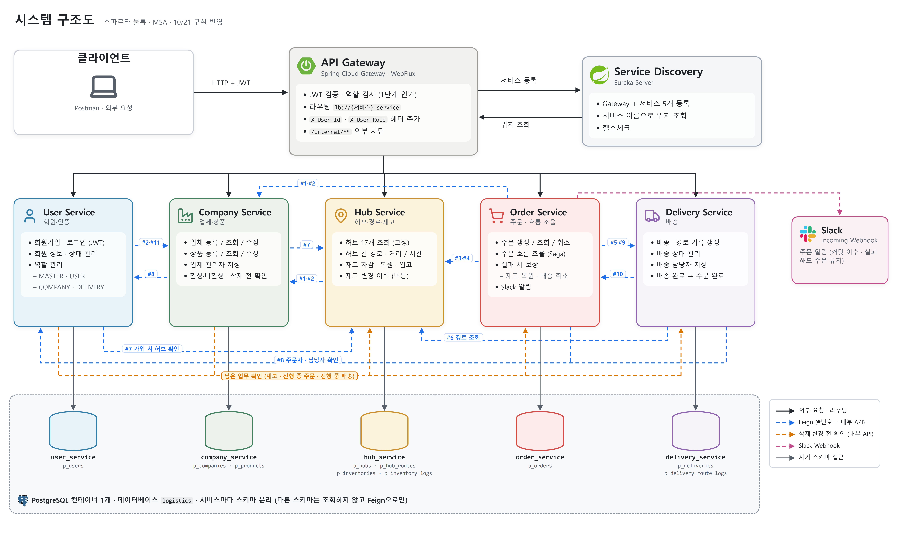
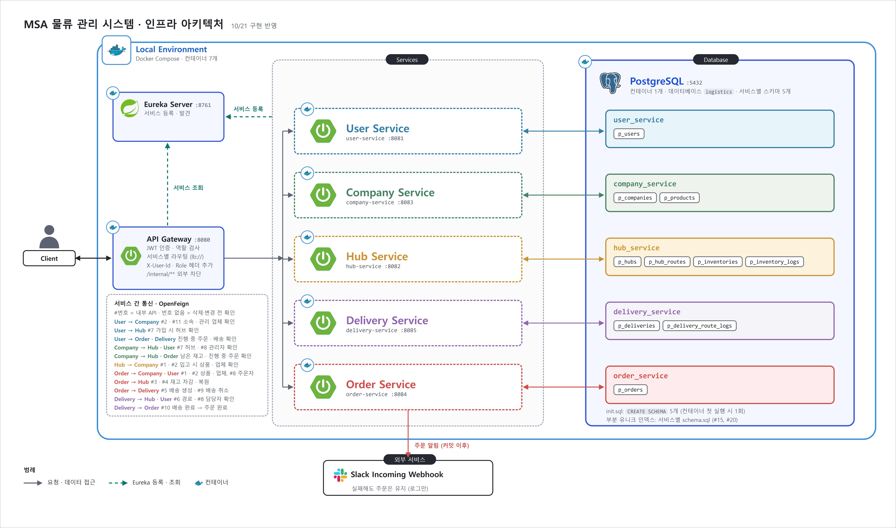
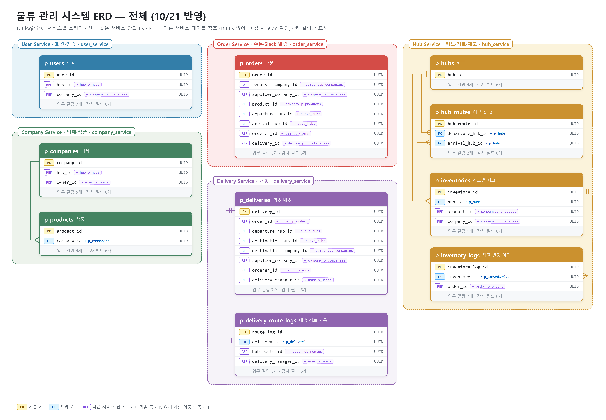

# 육사발 물류 MSA (logistics-msa)

Spring Boot와 Spring Cloud로 만든 B2B 물류 관리·배송 시스템입니다.
업체가 다른 업체의 상품을 주문하면, 공급 업체의 관리 허브에서 재고가 빠지고, 허브 사이를 거쳐 요청 업체까지 배송됩니다.

> 스파르타 내일배움캠프 단기심화 10기 숙련 프로젝트 · 6조 육사발

## 목차
1. [프로젝트 목적](#1-프로젝트-목적)
2. [서비스 구성](#2-서비스-구성)
3. [팀원 역할분담](#3-팀원-역할분담)
4. [주요 설계 결정](#4-주요-설계-결정)
5. [ERD](#5-erd)
6. [기술 스택](#6-기술-스택)
7. [실행 방법](#7-실행-방법)
8. [API 문서](#8-api-문서)
9. [테스트](#9-테스트)
10. [문서](#10-문서)

---

## 1. 프로젝트 목적

서비스를 나누고, 서비스끼리 통신하고, 각자 독립된 DB를 가진 구조(MSA)를 직접 설계하고 구현해 보는 것이 목표입니다.
서비스마다 DB가 따로라 **여러 서비스에 걸친 일을 한 트랜잭션으로 묶을 수 없고**, 이 프로젝트의 설계 결정 대부분은 여기서 출발했습니다.

**주요 흐름**

```
업체 주문 → 공급 업체 허브 재고 차감 → 배송·경로 기록 생성 → Slack 알림
         → 허브 간 이동 → 요청 업체로 배송 → 배송 완료 → 주문 완료
```

- 허브 17개와 허브 간 경로(P2P)는 고정 데이터로 적재
- 역할 4단계: 관리자(MASTER) · 일반(USER) · 업체 관리자(COMPANY) · 배송 담당자(DELIVERY)
- 모든 삭제는 논리 삭제(`deleted_at`, `deleted_by`)

---

## 2. 서비스 구성



| 서비스 | 포트 | 하는 일 |
| --- | --- | --- |
| eureka-server | 8761 | 서비스 등록·조회 |
| api-gateway | 8080 | 모든 외부 요청의 입구. JWT 검증, 경로별 역할 검사, `/internal/**` 차단, 통합 Swagger |
| user-service | 8081 | 회원가입·로그인(JWT 발급), 회원 상태·역할·소속 |
| hub-service | 8082 | 허브·허브 간 경로 조회, 재고 입고·차감·복원·조정과 변경 이력 |
| company-service | 8083 | 업체·상품 관리, 활성·비활성, 삭제 전 남은 업무 확인 |
| order-service | 8084 | 주문 생성(흐름 조율·보상), 취소, 완료, Slack 알림 |
| delivery-service | 8085 | 배송·경로 기록 생성, 상태 변경, 담당자 지정, 배송 완료 시 주문 완료 알림 |
| common | - | 공통 응답·오류 코드, 예외 처리, Feign 공통 설정(재시도·오류 변환) |

- DB: PostgreSQL 하나에 서비스마다 스키마를 분리(`user_service`, `hub_service`, …). 다른 서비스의 데이터는 ID로만 가리키고, 필요하면 내부 API(Feign)로 조회합니다.
- 외부 요청은 모두 게이트웨이(8080)를 거칩니다. 서비스 포트는 Docker 실행 시 외부에 열지 않습니다.

<details>
<summary>인프라 구성도</summary>



</details>

---

## 3. 팀원 역할분담

| 역할 | 담당 서비스 | 서비스 밖에서 맡은 일 |
| --- | --- | --- |
| user 담당 | user-service, api-gateway | 게이트웨이 인증·인가(역할 검사, 헤더 전달) |
| hub 담당 | hub-service | 재고 동시성·중복 요청 처리, 허브·경로 초기 데이터 |
| company 담당 (팀장) | company-service | 전체 서비스 통합 테스트, 설계 문서(ERD·구조도·결정 기록) |
| order 담당 | order-service | 초기 개발 환경(멀티 모듈, Docker Compose, Eureka), common 모듈 |
| delivery 담당 | delivery-service | 서비스 간 호출 재시도 설정 |

---

## 4. 주요 설계 결정

서비스마다 DB가 따로라 생긴 문제와, 검토한 선택지 중 고른 방법입니다. 각 결정은 팀 결정 기록에 고민 · 선택지 · 이유 · 감수한 점을 남겼습니다.

| 문제 | 고른 방법 | 이유 | 감수한 점 |
| --- | --- | --- | --- |
| **인가 · 신뢰 경계** — 서비스는 회원 정보를 직접 못 본다 | 게이트웨이는 역할, 각 서비스는 "내 업체·내 배송인지" 소유자 비교 | 토큰 검증을 한 곳에 모으고, DB가 필요한 판단만 서비스에 | 다른 서비스는 역할 변경이 토큰 만료(1시간)까지 늦게 반영 |
| **부분 실패 · 보상 (Saga)** — 주문이 일부만 성공한 채 남는다 | 주문 서비스가 순서대로 호출하고 실패하면 반대 작업으로 되돌림. 실패 주문은 지우지 않고 주문 상태와 보상 상태를 분리 | 흐름이 한 곳에 보이고, 실패 원인·복원 여부가 기록으로 남음 | 되돌리기 전 잠깐 데이터가 어긋남. 보상까지 실패하면 Slack 알림 후 사람이 처리 |
| **응답 없음** — 성공인지 실패인지 모른다 | 타임아웃은 "모름"으로 보고 재고 복원 + 배송 취소까지 | 배송 취소는 없으면 그냥 성공하게 만들어, 모를 때 다 되돌리는 쪽이 안전 | 재시도가 생기므로 멱등성이 반드시 필요 |
| **멱등성 · 동시성** — 재시도·복원·다른 주문이 같은 재고에 겹친다 | 재고 변경을 주문 번호 + 변경 종류로 기록(부분 유니크), 재고 행을 맨 앞에서 잠그고 조건부 차감 | 같은 요청은 한 번만, 겹치는 요청은 줄을 세워 수량이 항상 맞음 | 같은 재고 요청끼리 대기 |
| **경쟁 조건** — 배송 완료와 주문 취소가 부딪친다 | 배송이 거절 이유를 코드로 나눠 응답(이미 출발 / 다른 요청과 겹침 / 이미 완료) | 받는 쪽이 이유에 맞게 대응. 타이밍·스키마와 무관 | 수 ms 안에 겹치는 더 좁은 경우는 남음 |
| **서비스 간 참조 무결성** — 지우려는 데이터를 다른 서비스가 아직 쓴다 | 비활성화 → 남은 업무(재고·진행 중 주문·배송) 확인 → 삭제. 확인 못 하면 막음 | 재고는 실물이라 지우면 안 됨. 비활성 상태로 확인과 삭제 사이에 새 거래를 끊음 | 다른 서비스 장애 중엔 삭제 불가 |

---

## 5. ERD



- 서비스마다 스키마 하나, 테이블 이름은 `p_` 접두사
- 서비스 사이 관계는 외래 키 없이 ID로만 참조
- 논리 삭제를 쓰므로 유니크 제약은 "삭제되지 않은 행만" 대상인 부분 유니크 인덱스로 관리

---

## 6. 기술 스택

| 구분 | 사용 |
| --- | --- |
| 언어·프레임워크 | Java 17, Spring Boot 3.3.13 |
| MSA | Spring Cloud 2023.0.6 (Gateway, Eureka, OpenFeign) |
| 데이터 | Spring Data JPA, PostgreSQL 16 |
| 인증 | Spring Security, JWT(JJWT), BCrypt |
| 문서 | springdoc-openapi (Swagger UI, 게이트웨이 통합) |
| 알림 | Slack Incoming Webhook |
| 실행·테스트 | Docker Compose, JUnit 5, Mockito |

---

## 7. 실행 방법

필요: JDK 17 이상, Docker(Compose v2)

```bash
git clone https://github.com/yuksabal-team6/logistics-msa.git
cd logistics-msa
cp .env.example .env        # JWT_SECRET 입력 (openssl rand -base64 32)
./gradlew build -x test
docker compose up -d --build
```

- 모든 서비스가 뜨면 http://localhost:8761 에서 6개 앱(게이트웨이 + 서비스 5개)이 UP인지 확인합니다.
- 요청은 게이트웨이(http://localhost:8080)로 보냅니다.
- 처음 관리자(MASTER) 계정은 회원가입으로 만들 수 없습니다. 테스트용 관리자 계정이 필요하면 `docker-compose.it.yml`을 함께 씁니다(계정 정보는 파일 참고).

```bash
docker compose -f docker-compose.yml -f docker-compose.it.yml up -d --build
```

- 종료: `docker compose down` / DB까지 초기화: `docker compose down -v`
- 코드를 고친 뒤에는 `./gradlew build -x test`부터 다시 실행합니다(빌드한 jar로 이미지를 만듭니다).
- IntelliJ로 서비스별 실행, 로그 확인 등은 [프로젝트 세팅 가이드](docs/PROJECT_SETUP.md)를 참고하세요.

---

## 8. API 문서

- **통합 Swagger**: http://localhost:8080/swagger-ui/index.html → 오른쪽 위에서 서비스 선택, Authorize에 로그인 토큰 입력
- 외부 API는 `/api/v1/**`, 서비스끼리 쓰는 내부 API는 `/internal/**`(게이트웨이에서 차단)

| 서비스 | 외부 API | 내부 API (호출하는 쪽) |
| --- | --- | --- |
| user | `/api/v1/auth`, `/api/v1/users` | `/internal/users` (order, company, delivery) |
| hub | `/api/v1/hubs`, `/api/v1/hub-routes`, `/api/v1/inventories` | `/internal/stocks` 차감·복원 (order), `/internal/hub-routes` (delivery), `/internal/hubs`·`/internal/inventories` (company, user) |
| company | `/api/v1/companies`, `/api/v1/products` | `/internal/products`, `/internal/companies` (order, hub, user) |
| order | `/api/v1/orders` | `/internal/orders` 완료 알림·진행 중 주문 확인 (delivery, company, user) |
| delivery | `/api/v1/deliveries`, `/api/v1/deliveries/{id}/routes` | `/internal/deliveries` 생성·취소·진행 중 확인 (order, user) |

내부 API 계약은 제공하는 쪽이 쓰고, 호출하는 쪽이 확인했습니다.

---

## 9. 테스트

| 단계 | 범위 | 실행 |
| --- | --- | --- |
| 단위 | 서비스 로직 (저장소·다른 서비스는 가짜) | `./gradlew test` |
| 서비스 통합 | Controller → DB (다른 서비스만 가짜) | `./gradlew test` |
| **전체 통합** | 게이트웨이 → 모든 서비스 → DB, 가짜 없음 | `./gradlew :integration-test:integrationTest` (서비스를 먼저 띄운 뒤) |

- 각 서비스 담당자가 작성한 테스트 시나리오 **69개 모두 통과**
  - 테스트 코드로 확인 53개 (통합 테스트 메서드 51개, 그중 2개는 같은 상황의 시나리오 2개를 함께 확인)
  - 특수 상황을 연출해 확인 14개 (서비스 중지, DB 잠금, 동시 요청 등 자동화하기 어려운 장애·경합)
  - 같은 상황을 다룬 다른 시나리오의 테스트로 함께 확인 2개
- 반복되는 테스트 코드 작성과 특수 상황 연출은 Claude Code로 진행했습니다. 기대 결과와 다르면 테스트를 맞추지 않고 버그 이슈로 넘기는 규칙을 문서로 고정해 두었습니다
- 통합 테스트로 찾아 고친 문제: 배송 완료와 주문 취소가 동시에 오면 주문만 확정으로 남던 경합 (#196), 관리 허브 변경 시 재고가 이전 허브에 남는 문제 (#161)
- 자세한 실행 방법과 시나리오 작성 규칙: [integration-test/README.md](integration-test/README.md)

---

## 10. 문서

- [프로젝트 세팅 가이드](docs/PROJECT_SETUP.md): 구조, 실행, 코드 작성 규칙, Swagger, DB
- [GitHub 협업 가이드](docs/GITHUB_GUIDE.md): 브랜치, 이슈, 커밋, PR 규칙
- [통합 테스트](integration-test/README.md): 실행, 시나리오 추가 규칙
